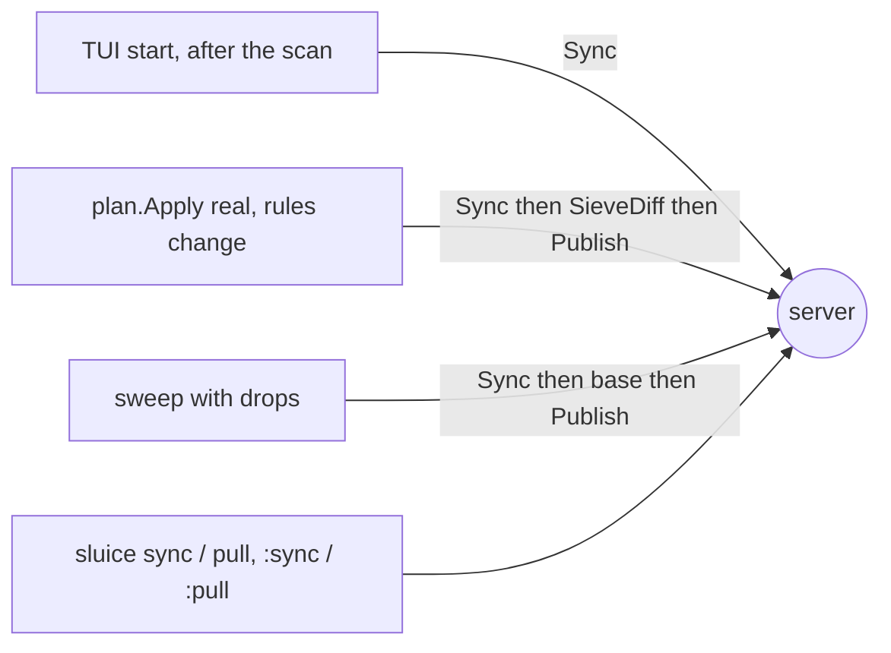

# Rule sync across machines

Package: `internal/sieve` (`sync.go`). Related: [remote.md](remote.md), [managed-block.md](managed-block.md),
[../apply/plan.md](../apply/plan.md), [../sweep.md](../sweep.md), [../doctor.md](../doctor.md).

## Why
sluice edits a **local** file (`sieve_file`, `~/.config/sieve/kolab.sieve`) and publishes it whole.
With two machines (desk runs the sweep service, laptop runs the TUI) each one's local file goes
stale as soon as the other publishes; before this, a stale or missing local file was "drift" and
every apply was refused, and a new machine showed no rules at all.

## Model
The **server script is the source of truth**. Each machine records the fingerprint (sha256 of the
whitespace-normalized text) of the script it last published or pulled in `$XDG_STATE_HOME/sluice/sieve-synced`
(`config.SieveSync`, passed as `sieve.Remote.SyncState`). Comparing local file, server script and
that record is a three-way check:

```go
func classify(local string, localExists bool, remote string, remoteExists bool, record string) SyncState
```

| state | condition | `Sync` | `Publish` | doctor `-online` |
|---|---|---|---|---|
| `NoRemote` | script not on the server | nothing | first publish creates it | ! first apply creates it |
| `LocalMissing` | no local file (new machine) | **download** | `ErrBehind` | ! "server has newer rules" |
| `InSync` | local == server | record fingerprint | normal | ✓ |
| `Behind` | local == record, server differs | **fast-forward** (old → `.bak`) | `ErrBehind` | ! "server has newer rules" |
| `Ahead` | server == record, local differs (hand edits) | nothing | publishes the edits | ✓ "local edits not yet published" |
| `Conflict` | both differ from the record, or no record and they differ | `ErrConflict` | `ErrDrift` (= `ErrConflict`) | ! "`sluice pull`" |

`Pull` is a forced sync: it adopts the server's script in any state, backing a differing local file
up to `<file>.bak-<YYYYmmddTHHMMSS>` (a plain `.bak` for a fast-forward). Every successful publish,
sync and pull writes the record. `ServerStatus.Drift` now means `Conflict` only; `ServerStatus.Sync`
carries the state. An empty `SyncState` path (tests, the sandbox) disables the record, so any
difference is a conflict — the old behaviour.

## Where it runs

- `plan.Apply` and `sweep.Run` call `Sync` whenever the publisher is a `sieve.Syncer` (only
  `sieve.Remote`; the sandbox's `FilePublisher` isn't one), **before** reading the base script, so the
  change is computed on top of what the other machine published. An update shows up as
  `rules updated from server (+N −M)` in the apply report / sweep publish log.
- The TUI syncs once per session after the startup scan (`rulesSyncMsg`; status line on change,
  error with the `:pull` hint on conflict). The REAL confirm says `↻ … pulled in before applying`
  when behind; a conflict opens "Can't apply: rules changed here and on the server".
- `lockLocal` and `writeRecord` create missing directories, so a brand-new machine (no
  `~/.config/sieve`, no state dir) can sync.

## Verified (2026-10-15)
- Unit: `sync_test.go` — classify table; two machines on one fake server (new machine downloads,
  desk publishes, laptop `Status` = Behind and a stale publish is refused, sync fast-forwards with
  `.bak`, then it publishes); Ahead publishes local edits; Conflict refuses sync and publish without
  touching the file; Pull resolves with a timestamped backup. Machines start without their dirs.
- Live: dev box `sluice sync` → `rules in sync` (record written); a scratch "new machine" config
  with no dirs → `rules updated from server (+296 −0)`, identical to the dev box's file, second run
  in sync. (The first live run caught the missing-directory bug.)

## Caveats
- Startup sync logs in to ManageSieve, so it can trigger the 1Password prompt like any server call.
- Two machines publishing at nearly the same moment can race between one's sync and its publish.
  The loser's local file still equals its record while the server moved on, so its `Publish` sees
  `Behind` and fails with `ErrBehind` instead of overwriting; re-running the apply syncs and succeeds.
